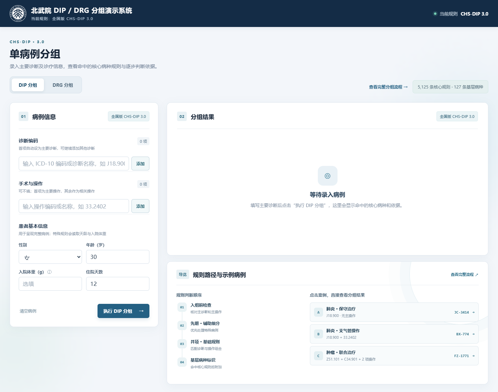
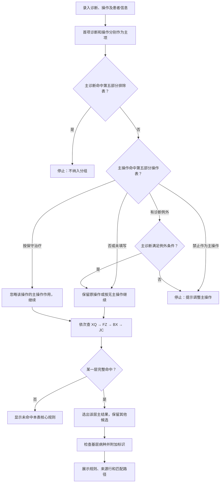
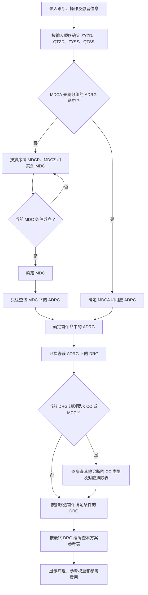
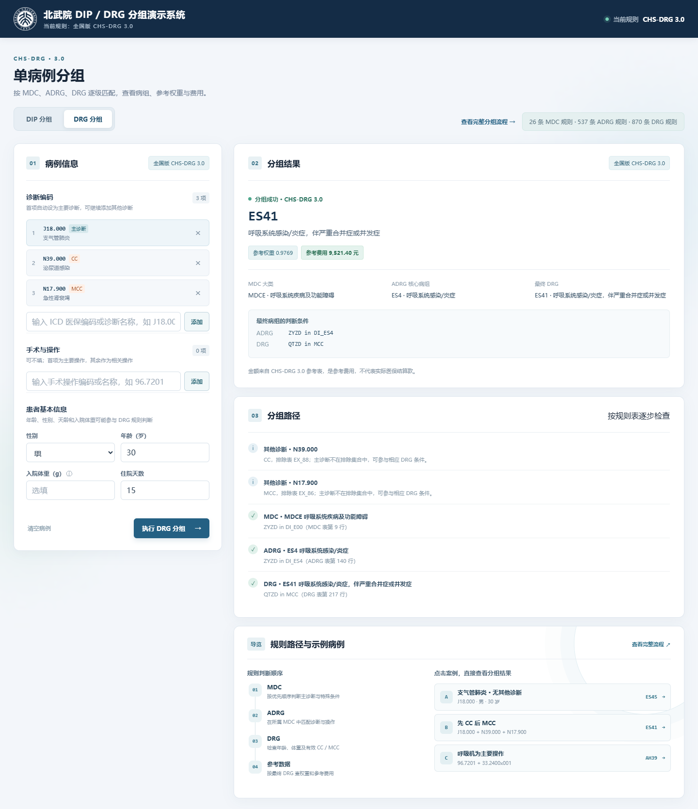
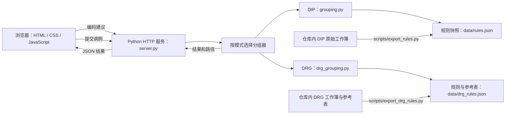

# CHS-DIP / CHS-DRG 3.0 分组演示系统

这是基于全国版 CHS-DIP 3.0 与 CHS-DRG 3.0 工作簿的单病例分组演示系统。DIP 展示核心病种规则、来源工作表与行号、完整匹配条件及判断路径；DRG 依次确定 MDC、ADRG 和最终 DRG，再查询对应参考权重与费用。两个方案在同一病例页面切换，已录入的诊断和操作会保留。

本地入口：启动服务后打开 [分组页面](http://127.0.0.1:8765/) · [完整分组流程](http://127.0.0.1:8765/flow.html)。

## 项目目录结构

下面列出仓库中的项目文件及其用途。

```text
DIP_Demo/
├── .gitignore                                      忽略 Python 缓存文件
├── README.md                                       项目说明、DIP/DRG 流程与运行方法
├── package.json                                    npm test 命令入口（实际测试由 Python 执行）
├── start-demo.cmd                                  Windows 前台启动脚本
├── restart-demo.ps1                                Windows 后台重启及 DRG 接口检查
├── server.py                                       本地 HTTP 服务、页面与分组接口
├── grouping.py                                     DIP 规则解释、匹配及结果生成
├── drg_grouping.py                                 DRG 表达式、MDC/ADRG/DRG、CC 排除与参考表查询
├── index.html                                      单病例分组首页和 DIP/DRG 切换按钮
├── app.js                                          病例输入、编码建议、接口调用及结果展示
├── styles.css                                      首页样式与淡入淡出切换
├── flow.html                                       DIP/DRG 详细分组流程、案例与易错点
├── flow.js                                         流程页同页翻页切换
├── flow.css                                        流程页样式
├── assets/
│   └── pku-logo.png                                页面校徽图片
├── data/
│   ├── rules.json                                  DIP 工作簿导出的运行规则快照
│   ├── drg_rules.json                              DRG 六张规则表及参考数据的运行快照
│   └── source/
│       ├── 按病种分值（DIP）付费3.0版分组方案.xlsx       DIP 原始规则工作簿
│       ├── 按病组（DRG）付费3.0版分组方案配置信息.xlsx DRG 原始配置工作簿
│       └── chs_drg_30_reference.js                 CHS-DRG 3.0 参考权重与费用源数据
├── docs/
│   └── images/
│       ├── homepage.png                            首页预览图
│       └── drg.png                                 DRG 分组结果预览图
├── scripts/
│   ├── export_rules.py                             从 DIP 工作簿重新生成 rules.json
│   ├── export_drg_rules.py                         从 DRG 工作簿和参考表生成 drg_rules.json
│   └── prepare-demo-start.ps1                      启动前检测并处理旧版 8765 服务
└── tests/
    ├── test_grouping.py                            DIP 规则单元测试
    ├── test_drg_grouping.py                        DRG 分组与边界案例测试
    └── test_api.py                                 HTTP 接口及静态文件测试
```

## 首页预览



## 功能概览

| 模式 | 规则依据 | 页面输出 |
| --- | --- | --- |
| CHS-DIP 3.0 | DIP 工作簿中的排除、先期分组、诊断辅助细分、并项、基础及基层病种规则 | 核心病种结果、依据、路径、同层备选及基层病种标识 |
| CHS-DRG 3.0 | DRG 工作簿中的 MDC、ADRG、DRG、集合、CC、排除表及配套参考表 | MDC → ADRG → DRG 路径、有效 CC/MCC 判断、参考权重与费用 |

- 按录入顺序区分主要诊断、其他诊断、主要操作和其他操作；手术操作可以不填。
- 对照两张“第五部分”工作表，检查主诊断是否被排除，并按说明处理主操作。
- 在先期分组（XQ）、诊断辅助细分（FZ）、并项规则（BX）、基础规则（JC）中查找完整满足条件的核心病种规则。
- 展示规则分类、序号、名称、来源行、命中条件和逐步判断路径；同层其他命中规则保留为备选。
- 命中核心规则后，检查“六、基层病种”并附加符合条件的标识。
- DRG 模式按配置工作簿的 MDC、ADRG、DRG 排序逐级判断；其他诊断的 CC/MCC 须经过对应排除表检查。
- DRG 模式按最终病组编码读取 CHS-DRG 3.0 参考权重与费用；缺失时显示“暂无参考数据”，不自行估算。
- [分组流程说明页面](flow.html)默认显示 DIP 流程，可点旁边按钮在同一页面翻页查看 DRG 总览、易错点与实测病例。

## 本地启动

运行环境：Python 3.10 或更新版本。启动服务与使用现有规则快照无需第三方 Python 包。

```bash
python server.py
```

浏览器打开 `http://127.0.0.1:8765/`。Windows 也可双击 `start-demo.cmd`。页面通过本地 Python 服务调用分组接口。

启动脚本会处理 8765 端口上的旧服务，再启动当前代码。

需要让同一内网的其他设备访问时，可按实际网络与安全配置启动：

```bash
python server.py --host 0.0.0.0 --port 8765
```

运行检查：

```bash
python -m unittest discover -s tests -v
```

## DIP 分组匹配流程



容易混淆的两点：

1. “不纳入分组的主要手术操作”命中后会读取该行说明；“按保守治疗入组”会忽略该操作的主操作作用，随后继续尝试四级规则。
2. 程序按 XQ → FZ → BX → JC 的顺序查找。同一层收集全部完整命中的规则，再按满足条件数、排序分数、序号选主结果。

操作规则中的 `+` 表示组合中的操作均需出现，`|` 表示可选项；编码还可能使用前缀或范围。具体匹配方式和第五部分各分支见[完整分组流程](flow.html)。

### 可直接验证的 DIP 输入

下表中的“第 1 项”表示主要诊断或主要操作，“第 2 项”表示其他诊断或其他操作。

| 第 1 项诊断 | 第 2 项诊断 | 第 1 项操作 | 第 2 项操作 | 演示结果 |
| --- | --- | --- | --- | --- |
| `J18.900` | — | — | — | `JC-3414`，可附加基层病种第 38 项 |
| `J18.900` | — | `33.2402` | — | `BX-774` |
| `J18.900` | — | `17.91350` | — | 按保守治疗处理主操作，继续查规则，命中 `JC-3414` |
| `J18.900` | — | `00.3101` | — | 提示该编码不可作为主要手术操作 |
| `Z51.101` | `C34.901` | `99.2503` | `99.2800x005` | `FZ-1771`；`FZ-1770` 为同层备选 |
| `Z51.101` | `C34.901` | `99.2800x005` | `99.2503` | 未命中这两条 FZ 规则；主次顺序影响匹配 |

## DRG 分组匹配流程





1. 确定输入角色。第一条诊断是主要诊断 `ZYZD`，其余为其他诊断 `QTZD`；第一条操作是主要操作 `ZYSS`，其余为其他操作 `QTSS`。性别、年龄、天龄、入院体重按规则参与判断。编码建议中的名称供查看，实际分组读取编码。
2. 确定 MDC。依工作簿排序先试 MDCA 先期分组的 ADRG；未命中再试新生儿、严重创伤及普通 MDC。规则如 `ZYZD in DI_B00`，要按完整编号 `DI_B00` 取“集合”表中的诊断编码，再判断主诊断是否在其中。`DI_` 表示诊断集合，`OP_` 表示手术／操作集合，不能只凭编号前缀合并多个集合。
3. 确定 ADRG。只检查已确定 MDC 下的 ADRG 行，按排序依次判断诊断、操作和其他条件，首个满足者给出 ADRG 编码与名称。
4. 确定 DRG。只检查当前 ADRG 下的 DRG 行。需要 CC/MCC 时，逐条查其他诊断在 CC 表中的类型，再用该条诊断对应的排除表检查主诊断；被排除者不能触发条件。按行排序选首个满足者，无条件末档承接未命中前面条件的病例。
5. 查询参考数据。当前方案 `chs_drg_30` 选定 CHS-DRG 3.0 参考表，以最终 DRG 编码精确查病组名称、权重和费用。多个诊断或操作共同决定一个病组，费用不逐项相加；缺少表值时显示“暂无参考数据”。

例如，女、30 岁、主诊断 `C49.503` 且没有其他诊断时，得到 `MDCN → NR1 → NR15`，参考权重 `0.8233`、参考费用 `8,023.82 元`。再加其他诊断 `I50.900x001`，经 CC 表与 `EX_45` 排除表核对后，得到 `MDCN → NR1 → NR13`，参考权重 `1.1906`、参考费用 `11,603.87 元`。完整逐步演算和易错点见[同页可切换的 DRG 流程说明](flow.html)。

入院体重只填数字，输入框已经标明单位 g；`999g` 会被拒绝。

## 数据来源与程序结构

仓库内的 `data/rules.json` 是从[《按病种分值（DIP）付费3.0版分组方案》](data/source/按病种分值（DIP）付费3.0版分组方案.xlsx)导出的规则快照，保留了工作表名称、Excel 行号和单元格值。原始 DIP 工作簿已放在 `data/source/`，可用于核对规则与重新导出。

`data/source/` 还保存了[《按病组（DRG）付费3.0版分组方案配置信息》](data/source/按病组（DRG）付费3.0版分组方案配置信息.xlsx)和 CHS-DRG 3.0 参考数据文件。执行 `scripts/export_drg_rules.py` 后，六张规则工作表及参考数据导出至 `data/drg_rules.json`；运行中的 `drg_grouping.py` 读取该快照。DIP 导出脚本生成 `data/rules.json`。

### DIP 规则快照

| 规则内容 | 条数 |
| --- | ---: |
| 先期分组 XQ | 19 |
| 诊断辅助细分 FZ：烧伤、肿瘤、结核 | 113 |
| 并项规则 BX | 1,725 |
| 基础规则 JC | 3,268 |
| 核心规则合计 | 5,125 |
| 不纳入分组的主要诊断 | 4,742 |
| 不纳入分组的主要手术操作 | 4,111 |
| 基层病种 | 127 |

另有耐药结核诊断目录 48 条，供对应的 FZ 分支判断使用。

### DRG 规则快照

| 规则内容 | 条数 |
| --- | ---: |
| MDC 大类规则 | 26 |
| ADRG 核心病组规则 | 537 |
| DRG 最终病组规则 | 870 |
| `DI_` 诊断编码集合 | 280 |
| `OP_` 手术／操作编码集合 | 250 |
| CC/MCC 诊断编码 | 7,918 |
| 排除集合 | 148 |
| CHS-DRG 3.0 参考病组 | 825 |

参考表的 825 个病组中有 7 个缺少权重或费用，页面对这些病组显示“暂无参考数据”。



需要从仓库内的 DIP 工作簿重新导出规则数据时，先安装 `openpyxl`，再运行：

```bash
python -m pip install openpyxl
python scripts/export_rules.py
```

也可以把其他 DIP 工作簿的完整路径作为参数传给该脚本；导出逻辑会按工作表名称读取，并修复操作排除表中以数值保存的 `33.24` 为完整编码 `33.2400`。

重新导出 DRG 快照也需要 `openpyxl`：

```bash
python scripts/export_drg_rules.py
```

导出后重新启动 Python 服务，使新快照生效。运行服务与现有快照无需第三方 Python 包。

