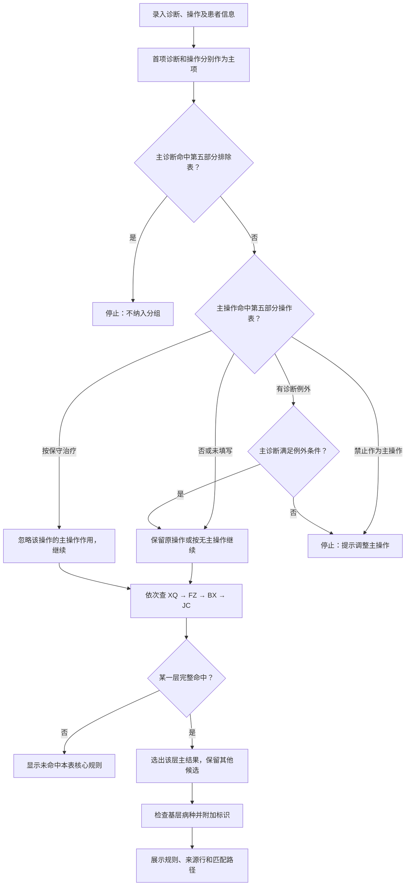
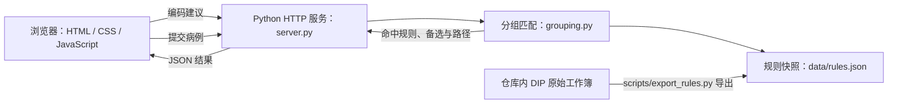

# DIP 3.0 病种分组演示系统

基于《按病种分值（DIP）付费3.0版分组方案》的单病例规则匹配演示。录入诊断和手术操作编码后，系统展示命中的核心病种规则、来源工作表与行号、匹配条件及判断路径。界面固定使用全国版 DIP 3.0。

**在线演示：**[打开分组页面](https://medicineai.taildeb29a.ts.net/) · [查看完整分组流程](https://medicineai.taildeb29a.ts.net/flow.html)

> 在线演示运行在维护者的电脑上；电脑或服务停止时，链接可能暂时无法访问。本仓库提供可独立运行的源码和规则数据快照。

## 首页预览


## 功能

- 按录入顺序区分主要诊断、其他诊断、主要操作和其他操作；手术操作可以不填。
- 对照两张“第五部分”工作表，检查主诊断是否被排除，并按说明处理主操作。
- 在先期分组（XQ）、诊断辅助细分（FZ）、并项规则（BX）、基础规则（JC）中查找**完整满足条件**的核心病种规则。
- 展示规则分类、序号、名称、来源行、命中条件和逐步判断路径；同层其他命中规则保留为备选。
- 命中核心规则后，检查“六、基层病种”并附加符合条件的标识。
- 提供独立的[分组流程说明页面](flow.html)，解释编码匹配、`+` 与 `|` 等规则表达式及代表性案例。

适用范围：这是规则匹配演示，不是医保结算或临床决策系统。所用工作簿未提供完整综合病种目录、费用分值和结算规则；未命中核心规则时，系统不会自行生成综合病种或费用结果。

## 本地启动

运行环境：Python 3.10 或更新版本。启动服务与使用现有规则快照无需第三方 Python 包。

```bash
python server.py
```

浏览器打开 `http://127.0.0.1:8765/`。Windows 也可双击 `start-demo.cmd`。必须通过 Python 服务访问页面；直接打开 `index.html` 无法调用分组接口。

需要让同一内网的其他设备访问时，可按实际网络与安全配置启动：

```bash
python server.py --host 0.0.0.0 --port 8765
```

运行检查：

```bash
python -m unittest discover -s tests -v
```

## 分组匹配流程



**容易混淆的两点：**

1. “不纳入分组的主要手术操作”不等于病例一律终止。命中后必须读取该行说明；“按保守治疗入组”只忽略它作为主操作的分组作用，后续仍尝试四级规则，也不保证一定命中 JC。
2. XQ → FZ → BX → JC 是**当前程序采用的查找顺序**。同一层会先收集全部完整命中的规则，再按满足条件数、排序分数、序号选主结果；这套取舍方式是演示系统的实现策略，不应直接当作国家规定的规则优先级。

操作规则中的 `+` 表示组合中的操作均需出现，`|` 表示可选项；编码还可能使用前缀或范围。具体匹配方式和第五部分各分支见[完整分组流程](flow.html)。

### 可直接验证的输入

下表中的“第 1 项”表示主要诊断或主要操作，“第 2 项”表示其他诊断或其他操作。

| 第 1 项诊断 | 第 2 项诊断 | 第 1 项操作 | 第 2 项操作 | 演示结果 |
| --- | --- | --- | --- | --- |
| `J18.900` | — | — | — | `JC-3414`，可附加基层病种第 38 项 |
| `J18.900` | — | `33.2402` | — | `BX-774` |
| `J18.900` | — | `17.91350` | — | 按保守治疗处理主操作，继续查规则，命中 `JC-3414` |
| `J18.900` | — | `00.3101` | — | 提示该编码不可作为主要手术操作 |
| `Z51.101` | `C34.901` | `99.2503` | `99.2800x005` | `FZ-1771`；`FZ-1770` 为同层备选 |
| `Z51.101` | `C34.901` | `99.2800x005` | `99.2503` | 未命中这两条 FZ 规则；主次顺序影响匹配 |

## 数据来源与程序结构

仓库内的 `data/rules.json` 是从[《按病种分值（DIP）付费3.0版分组方案》](data/source/按病种分值（DIP）付费3.0版分组方案.xlsx)导出的规则快照，保留了工作表名称、Excel 行号和单元格值。原始 DIP 工作簿已放在 `data/source/`，可用于核对规则与重新导出。

`data/source/` 还保存了[《按病组（DRG）付费3.0版分组方案配置信息》](data/source/按病组（DRG）付费3.0版分组方案配置信息.xlsx)。当前项目实现的是 **DIP 分组演示**；该 DRG 工作簿作为参考资料提供，**不参与当前分组计算**。导出脚本按工作表名称读取，并将操作排除表中以数值存储的 `33.24` 恢复为完整编码 `33.2400`，以保持规则快照可复现。

| 规则内容 | 条数 |
| --- | ---: |
| 先期分组 XQ | 19 |
| 诊断辅助细分 FZ：烧伤、肿瘤、结核 | 113 |
| 并项规则 BX | 1,725 |
| 基础规则 JC | 3,268 |
| 核心规则合计 | **5,125** |
| 不纳入分组的主要诊断 | 4,742 |
| 不纳入分组的主要手术操作 | 4,111 |
| 基层病种 | 127 |

另有耐药结核诊断目录 48 条，供对应的 FZ 分支判断使用。



主要文件：

- `index.html`、`styles.css`、`app.js`：分组页面和交互。
- `flow.html`、`flow.css`：规则流程说明。
- `server.py`：静态页面、`/api/catalog` 编码建议和 `/api/group` 分组接口。
- `grouping.py`：编码匹配、排除判断、候选选择及基层标识。
- `data/rules.json`：服务启动时加载的规则快照。
- `data/source/`：DIP 3.0 与 DRG 3.0 原始工作簿；当前仅 DIP 工作簿用于导出规则。
- `scripts/export_rules.py`：从工作簿重新导出快照。
- `tests/`：分组规则和 HTTP 接口检查。

需要从仓库内的 DIP 工作簿重新导出规则数据时，先安装 `openpyxl`，再运行：

```bash
python -m pip install openpyxl
python scripts/export_rules.py
```

也可以把其他工作簿的完整路径作为参数传给脚本。导出后重新启动 Python 服务，使新快照生效。

